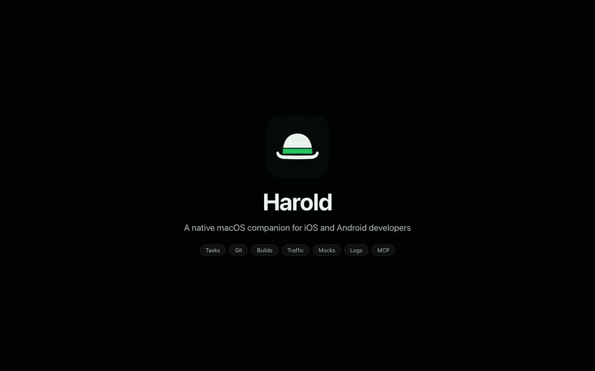
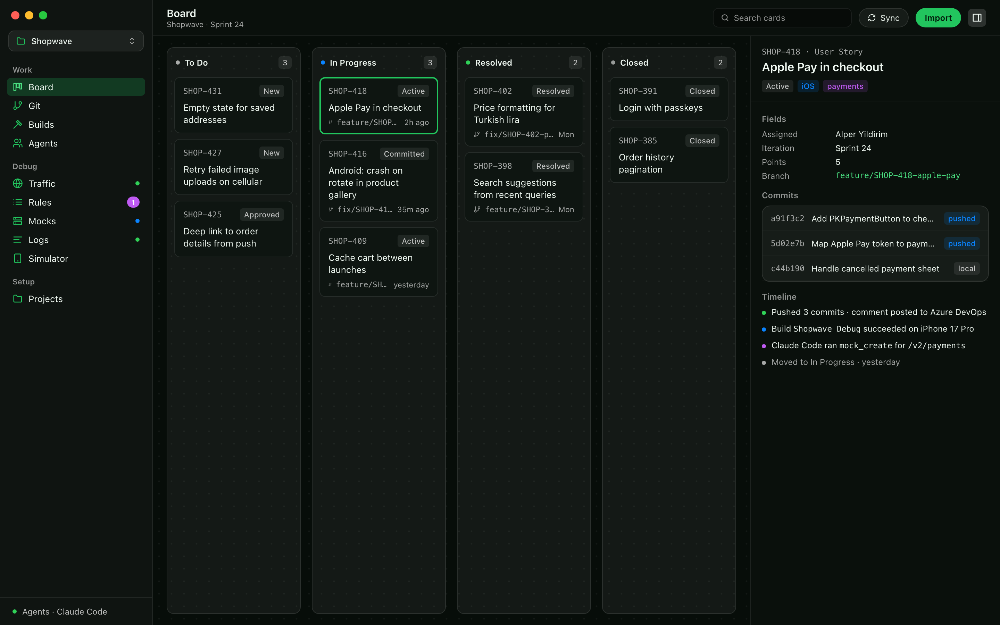
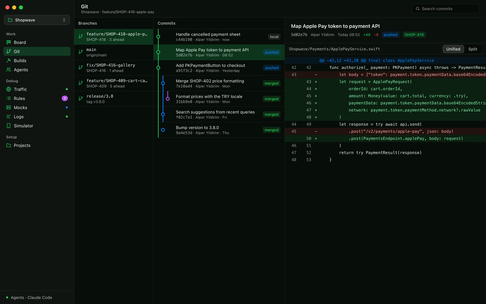
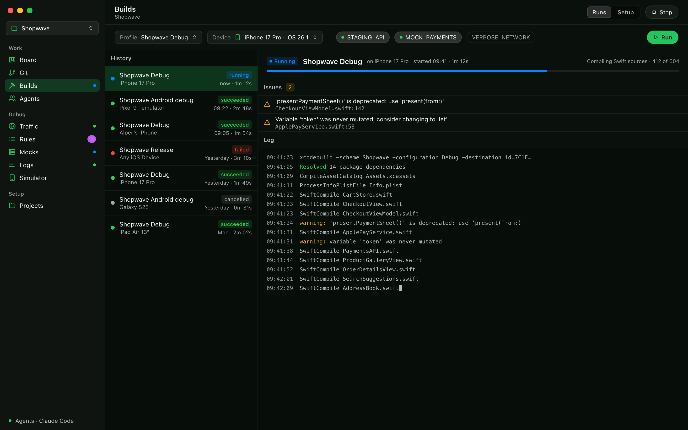
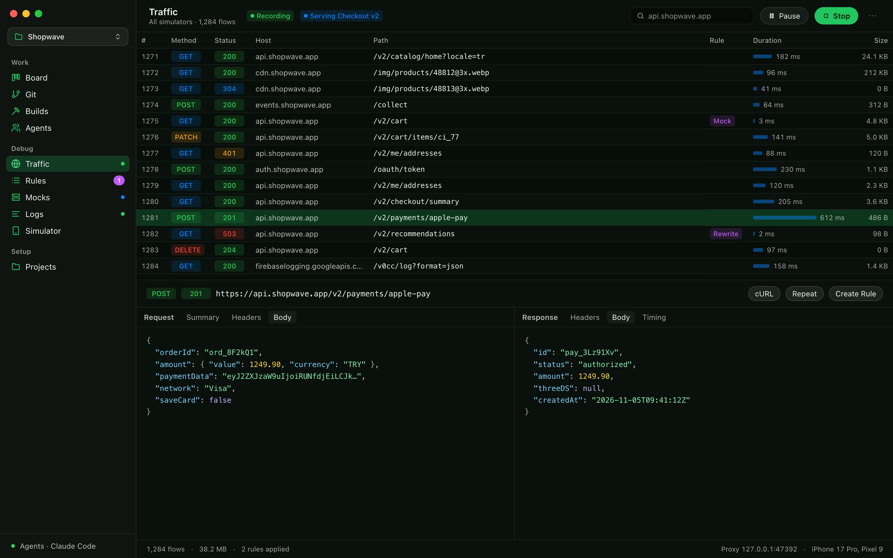
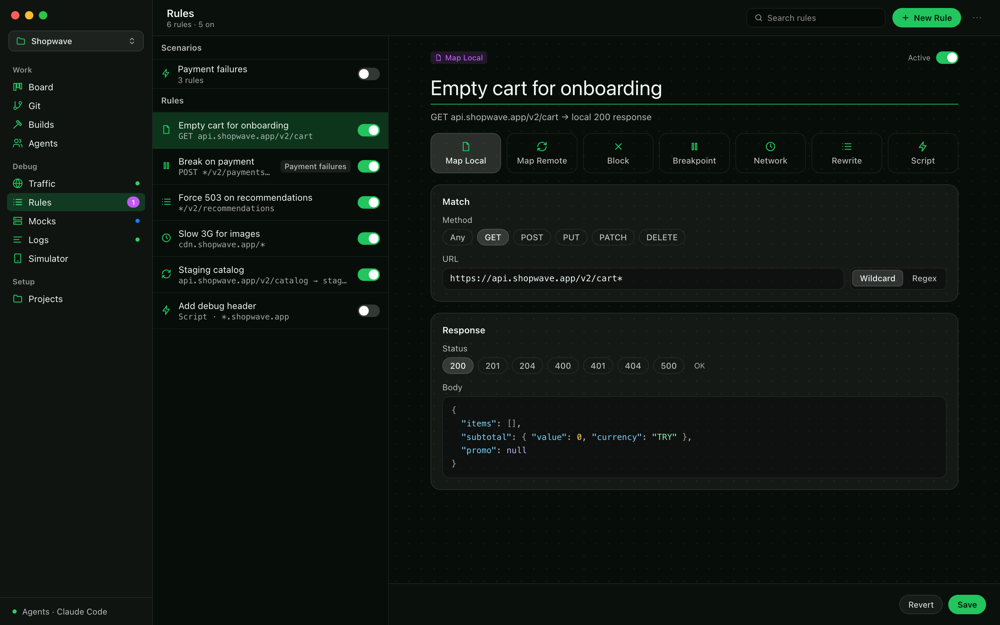
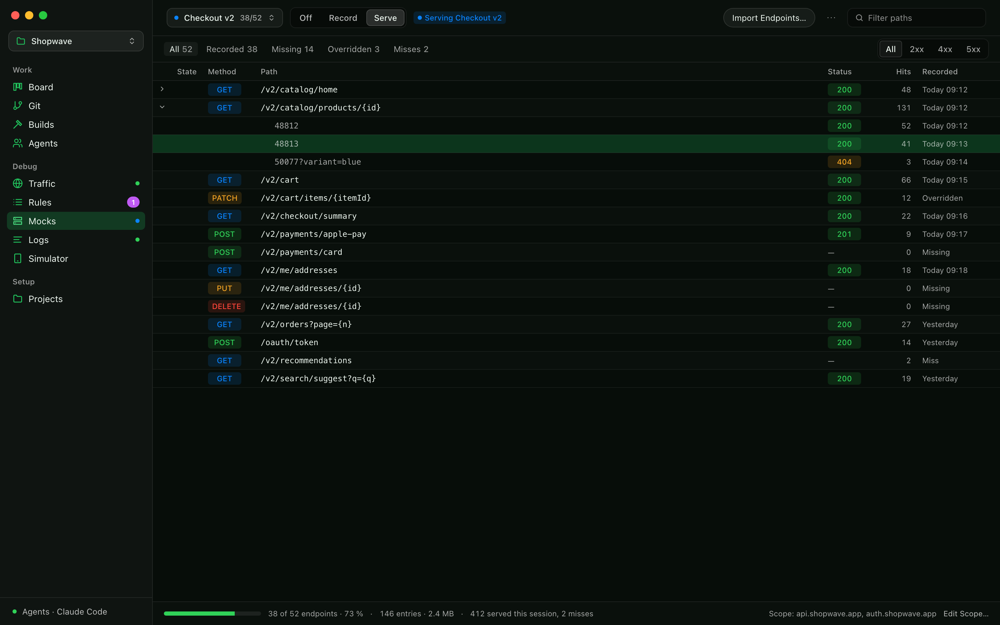
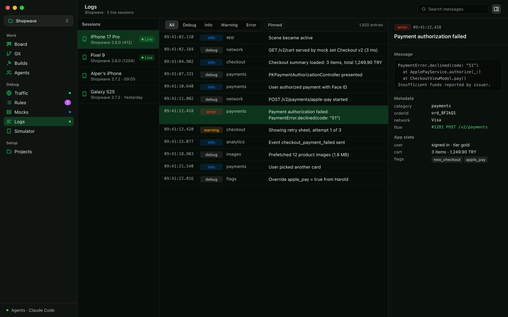
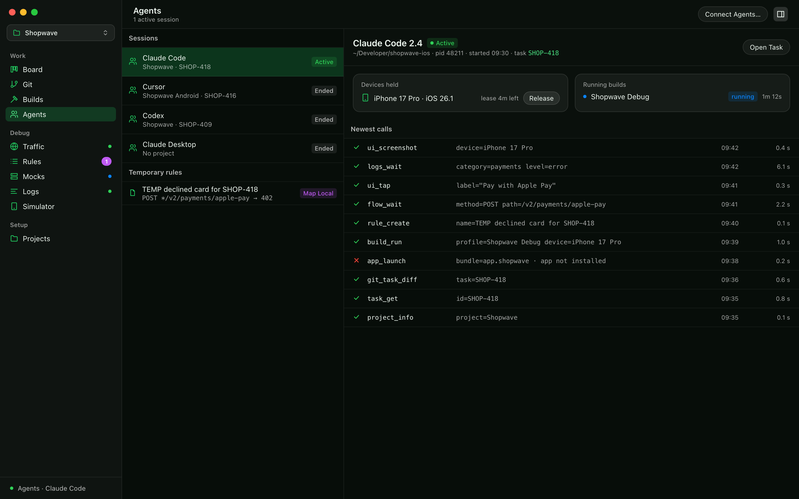

# Harold

**Your iOS and Android dev tools in one Mac app.**

 

### [Download the latest release](https://github.com/repfly/harold-releases/releases/latest)

[Video tour](docs/media/harold-demo.mp4)

The screens are mockups with sample data.

## At a glance

| | |
|---|---|
| [**Task board**](#task-board) | Your sprint from Azure DevOps, Jira or GitLab |
| [**Git**](#git) | Commits link to tasks by id |
| [**Builds**](#builds) | Xcode and Gradle, one click per device |
| [**Traffic**](#traffic) | See every simulator request. No code change |
| [**Rules**](#rules-and-scripts) | Mock, block, slow down or edit requests |
| [**Mock server**](#mock-server) | Record the API once, work offline |
| [**Logs SDK**](#logs-sdk) | App logs and state on your Mac |
| [**Simulator**](#simulator-tools) | Deep links, push, location, snapshots |
| [**AI agents**](#ai-agents-mcp) | Your agent gets all of the above |

## Install

1. Download the `.dmg` from the [latest release](https://github.com/repfly/harold-releases/releases/latest).
2. Drag Harold to Applications.
3. Open it. The **Welcome** window sets you up.

Signed and notarized by Apple. Needs macOS 26 or later. Updates come by themselves.

<b>Updates and the Welcome window</b>

**Updates:** Harold checks once a day. Check now with **Harold › Check for Updates…**, or change the setting in **Settings › Updates**.

**Welcome window:** each step except the first can be skipped. Open it again with **Help › Welcome to Harold**.

1. **Your Mac.** Checks for Xcode, simulator runtimes, the Android SDK, `adb`, `git` and agent clients.
2. **First project.** Choose a folder that holds an Xcode or Gradle project.
3. **Tracker.** Connect Azure DevOps, Jira or GitLab with a personal access token.
4. **Network capture.** Install the helper and trust the Harold certificate on your simulators.
5. **Logs SDK.** Add the SDK to your iOS or Android app.
6. **Agents.** Connect your AI agent with one click.

The **Getting Started** card at the bottom of the sidebar shows what is left.

---

## Task board

Your sprint on a board. Drag a card, and the ticket moves too.

<b>How to use</b>

Every project has its own board. The default columns are To Do, In Progress, Resolved and Closed.

**Connect a tracker**

1. Open **Projects** and select your project.
2. In **Tracker**, choose the provider and paste a token. Harold checks the token and stores it in the Keychain.
3. Set a **Git Host** if your code is on Azure Repos, GitLab or Bitbucket.

| Provider | Tasks | Code and PRs | Id format |
|---|---|---|---|
| Azure DevOps | Boards | Repos | `7514`, `AB#7514` |
| Jira (Cloud, Data Center) | Issues | — | `PROJ-123` |
| GitLab (.com, self-managed) | Issues | Repos, MRs | `#123` |
| Bitbucket (Cloud, Server) | — | Repos, PRs | — |

**Get tasks onto the board**

- **Import:** paste a ticket id. The card goes into the column mapped to its tracker state.
- **Sync:** pulls the open items assigned to you in the current sprint (up to 100 per project). It never writes to the tracker.

**Work with cards**

- Drag a card to a column. If the column maps to a tracker state, Harold asks to **Push to board**. Turn on auto-push per project to skip the question.
- Columns can be added, renamed, recolored and reordered. They can have a WIP limit and a map to a tracker state (per work item type on Azure and Jira).
- Double-click a card for the full view: description, comments, related items, commits, timeline and attachments.
- Drop files on a task, or save flows, log lines, builds and screenshots to it.

> **Dry-run is on for each new project.** Tracker writes go to the task timeline only. Turn it off in the project settings when you trust the setup.

## Git

Commits link to tasks by id. A push posts one comment to the ticket.

<b>How to use</b>

Harold finds the task id in the commit message, the branch name or a manual link. Each project can change the id pattern.

| Event | Default action |
|---|---|
| Commit | Add to the task timeline |
| Push | Post one comment on the ticket with the new commits |
| First push on a task | Move the ticket to "in progress" |
| PR merged | Move the ticket to "resolved" |

You can edit these rules per project. A commit that a rebase removed before a push is never posted.

The **Git** screen shows branches, remotes, a commit graph and side-by-side or unified diffs. A task shows the combined diff of all its commits. The git view never writes.

## Builds

Pick a profile and a device, press Run.

<b>How to use</b>

A **build profile** holds a driver (Xcode or Gradle), a scheme or module, a configuration or variant, a device, flags and post-build steps.

1. Open **Builds › Setup** and add a profile.
2. Add **flags** if you need them. Each flag uses one mechanism:

   | Mechanism | Rebuild |
   |---|---|
   | Compile condition | Yes |
   | Build setting | Yes |
   | Launch argument | No |
   | Environment variable (iOS) | No |
   | SDK override (sent at launch and live) | No |

3. Go to **Runs**, choose the profile and the device, and press **Run**.

Errors and warnings group by file in the Issues list. Click an issue to jump to the log line. Double-click to open the file.

Harold checks that your configuration name exists before it builds. A wrong name like `Debug` instead of `Debug(DEV)` would otherwise build silently with a different configuration.

## Traffic

See every request your simulator apps make. No code change.

<b>How to use</b>

Harold runs its own HTTPS proxy. It decrypts traffic with a root certificate that Harold makes for your Mac and keeps in the Keychain.

**Capture iOS simulators**

1. Open **Settings › Proxy › Simulator Capture** and click **Install Helper**. Approve it once in System Settings › General › Login Items & Extensions.
2. In the same tab, click **Install CA** for each booted simulator.
3. In **Traffic**, keep the **Simulator Capture** switch on and press **Start**.

While capture is on, Harold records only simulator apps. Everything else on your Mac passes through untouched. Stop, quit and even a crash restore your own proxy settings.

**Capture Android**

Press Start, then turn on the route for the emulator or phone in **Settings › Proxy › Android Devices**. Harold sets the device proxy and removes it on stop. For HTTPS, install the Harold certificate as a user CA on the device.

**Read traffic**

- Filter by app, method, status class, text, or conditions on any field (host, path, headers, content type, response body).
- Save a set of conditions as a named filter.
- Select a flow to see the request and response side by side. JSON is formatted and colored.
- Right-click a flow: **Repeat**, **Edit and Repeat…**, **Copy as cURL**, **Export as HAR**, **Save to Task**, **Add to Bypass**, **Mock this response**.
- Turn on **Show logs** to see SDK log lines between the flows, by time.
- **Pause** stops recording, not forwarding. Rules still apply.

Hosts with certificate pinning show a "pinned / handshake failed" badge. Add them to the bypass list, or turn pinning off in debug builds.

## Rules and scripts

Mock, block, slow down or edit any request.

<b>How to use</b>

Rules act on all traffic. Open **Rules** and press `+`, or right-click a flow and choose **Create rule from flow**.

| Rule | What it does |
|---|---|
| Map Local | Returns a status, headers and a body from the editor or a file |
| Map Remote | Sends the request to another URL |
| Block | Stops the request |
| Breakpoint | Pauses the request or response so you can edit it |
| Network Condition | Adds latency, limits bandwidth, fails a percentage of requests |
| Rewrite | Edits headers and JSON-path fields with no code |
| Script | Runs JavaScript on the request or the response |

A rule matches on method, URL wildcard or regex, host, header, query, GraphQL operation name and client device.

**Scripts** use the same functions as Proxyman, so most Proxyman scripts work as they are.

**Scenarios** are named rule folders. Turn a whole scenario on or off at once, for example "Sprint 32 demo". A build profile can turn on a scenario at launch. Share a scenario as a `.haroldrules` file, or import your Proxyman rules.

## Mock server

Record your API once. Then work with no network.

<b>How to use</b>

1. Open **Mocks** and create a set. Choose the app, the hosts, or both.
2. Set the mode to **Record** and use your app. Each response is saved by method, URL and status (GraphQL by operation and variables).
3. Set the mode to **Serve**. The app now gets the recorded answers.

What else you can do:

- **Coverage:** click **Import Endpoints…** and paste an OpenAPI 2 or 3 JSON file, or a plain list of endpoints. The tabs show Covered, Missing and Unlisted endpoints.
- **Variants:** one endpoint can hold a 200, a 404 and a 500. Click a status chip to choose which one is served.
- **Edit** a recorded response, or turn it into a Map Local rule.
- **Re-record** one entry, an endpoint or the whole set on the next hit.
- **Miss policy:** pass through, pass through and record, or fail with `501`.
- **Share** a set as a `.haroldmocks` file. Auth and cookie header values are masked.

Only one set records or serves at a time. Rules always win over a serving set.

## Logs SDK

Your app's logs and state, live on your Mac. Debug builds only.

<b>How to use</b>

Small SDKs for iOS and Android send logs and app state from your debug builds to Harold. They are compiled out of release builds. The **Logs SDK** step of the Welcome window shows how to add the SDK to your app.

- The first time a device connects, Harold shows a pairing code. Allow it and pick a project.
- The **Logs** screen filters by level, category and text. Pin lines, or save a selection to a task.
- **State:** see the latest app state the SDK sent, for example the environment, the user and the screen.
- **Overrides:** send feature flag values to the running app, for example `tutorials=off`.

## Simulator tools

Drive the booted simulator or emulator: links, push, location and more.

<b>How to use</b>

Pick the device and the app in the toolbar of the **Simulator** screen.

| Section | What it does |
|---|---|
| Links | Opens deep links. Suggests your URL schemes and universal link domains |
| Push | Sends a JSON push payload (iOS) |
| Location | Sets a point, or plays a route at a set speed |
| Permissions | Grants, revokes or resets each permission |
| Snapshots | Saves and restores app state (iOS: data, app groups and keychain; Android: whole emulator) |
| Care | Restarts the device, deletes old clones, cleans DerivedData and Gradle builds |

**Screenshot** and **Record** (up to 60 s) save straight to a task as proof.

Save links, push payloads and locations as **presets** per project. Your agent can use them too.

Physical Android phones support links and screenshots only.

## AI agents (MCP)

Your agent builds, taps through the app, reads traffic and logs, and moves the card.

<b>Connect an agent</b>

Harold ships an MCP server, `harold-mcp`. Open **Settings › Agents** and click **Connect** next to your client: Claude Code, Codex, Claude Desktop or Cursor. Harold edits the client's config for you and keeps a backup. Use **Copy Setup** in the ⋯ menu for a manual setup.

<b>What an agent can do</b>

| Area | What it can do |
|---|---|
| Tasks | Import, sync and move tasks. Add notes and attachments |
| Git | Read the log, a commit, or the diff of a task |
| Builds | Run a profile, follow its status, read errors, launch the app |
| Traffic | Query flows, wait for a request, copy as cURL, export HAR |
| Rules | Create mocks, rules, scripts, breakpoints and network conditions |
| Mocks | Create mock sets, record, serve, read coverage |
| Logs | Query and wait for log lines, send overrides |
| Simulator | Open links, send push, set location, restore snapshots, take screenshots |
| UI | Read the screen, tap, type, swipe |

A typical loop: the agent fixes a bug, builds and launches the app, taps through it, waits for the request, saves a screenshot to the task, and moves the card.

The **Agents** screen shows each session, its task, its recent tool calls, its running builds and the devices it holds. Harold never records typed text, payloads or bodies. A warning shows when rules named `TEMP…` are still on after the agent left.

<b>Safety</b>

- Tracker writes from an agent obey dry-run and appear on the task timeline.
- No agent can turn on network access, allow a proxy client, install the helper or pair a phone. You do these in the app.
- Only one session can drive a device at a time. Click **Release** to take it back.

---

## Real devices

<b>iPhone (iOS 17+)</b>

- Builds, installs and launches over USB or Wi-Fi.
- For traffic and logs, the iPhone must be on the same Wi-Fi as the Mac. Turn on **Settings › Proxy › Network Access**. It is off at each app start.
- Allow each new device when Harold asks.
- Install the certificate from **Settings › Proxy › iPhones**, or scan the QR code on that screen. Then turn on full trust in Settings › General › About › Certificate Trust Settings.

<b>Android phone</b>

- Works over USB or wireless debugging. Use **Pair Android over Wi-Fi…** in the device menu of Builds.
- Traffic and logs go through `adb`, so no network access is needed.

